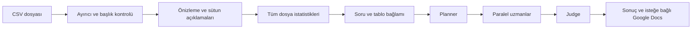

# n8n + OpenAI Çoklu Uzman Sistemi

Bu proje bir soruyu bağımsız uzman rollerine böler, uzman yanıtlarını paralel çalıştırır ve OpenAI Responses API ile tek bir nihai cevapta birleştirir. n8n workflow'ları kaynak gerçektir; Git deposundaki JSON dosyaları n8n'den dışa aktarılan sürümlerdir.

## Kolay yerel kurulum

Docker Desktop açıkken proje klasöründe tek komut çalıştırın:

```sh
bash scripts/start.sh
```

[Web arayüzünü açın](http://localhost:3000) ve OpenAI API anahtarınızı kurulum
ekranına girmeden önce ekrandaki bağlantıdan n8n yönetici hesabınızı oluşturun. Sekiz workflow otomatik içe aktarılır, OpenAI bağlantıları kurulur
ve analiz webhook'ları yayınlanır. Ayarlar yeniden başlatmalarda korunur.
Google Docs çıktısı isteğe bağlı olarak ayrıca etkinleştirilir.

Kurulum, yedekleme ve Google Docs adımları için
[yerel paket kılavuzuna](deployment/README.md) bakın. Aşağıdaki adımlar mevcut
n8n kurulumuna elle aktarım içindir.

Windows kullanıcıları `scripts/start.cmd` dosyasını çalıştırabilir.
Dağıtım öncesi kontrol sonuçları ve bilinen sınırlar [SECURITY.md](SECURITY.md)
dosyasında bulunur. Temiz ZIP paketi `python3 scripts/package-release.py` ile hazırlanır.

## Bileşenler

- `workflows/multi-agent-planner.json`: gerekli uzman rollerini üretir.
- `workflows/multi-agent-worker.json`: tek bir uzmanın görevini çalıştırır.
- `workflows/multi-agent-judge.json`: yanıtları birleştirir ve kısa sonuç üretir.
- `workflows/multi-agent-main.json`: n8n Chat Trigger akışıdır.
- `workflows/multi-agent-ui-*.json`: web arayüzünün Plan, Worker, Judge ve Google Docs webhook'larıdır.
- `ui/`: Next.js web arayüzüdür.
- `scripts/sync-n8n.sh`: yalnızca tanımlı sekiz workflow'u n8n'den mevcut dosyalarına aktarır.

## Gereksinimler

- n8n 2.x (paketlenen sürüm 2.46.6)
- Node.js 22+
- OpenAI API anahtarı
- Google Docs çıktısı kullanılacaksa Google Drive ve Google Docs API erişimi

## OpenAI credential kurulumu

API anahtarı Git'e veya workflow JSON dosyalarına yazılmaz. n8n'de bir **Header Auth** credential'ı oluşturun:

- Name: `OpenAI API`
- Header Name: `Authorization`
- Header Value: `Bearer YOUR_OPENAI_API_KEY`

Bu credential'ı aşağıdaki OpenAI HTTP Request node'larında seçin:

- `Multi-Agent Planner2 → Call OpenAI Planner`
- `Multi-Agent Worker2 → Call OpenAI Worker`
- `Multi-Agent Judge2 → Call Final Judge Synthesis`
- `Multi-Agent Judge2 → Call Final Judge Synthesis1`

Workflow JSON dosyalarında yalnızca taşınabilir credential referansı bulunur. Gerçek anahtar n8n'in şifreli credential deposunda kalır.

## Import sırası

1. `multi-agent-planner.json`
2. `multi-agent-worker.json`
3. `multi-agent-judge.json`
4. `multi-agent-main.json`
5. `multi-agent-ui-plan.json`
6. `multi-agent-ui-worker.json`
7. `multi-agent-ui-judge.json`
8. `multi-agent-ui-docs.json`

Import sonrasında OpenAI credential seçimlerini ve Execute Sub-workflow seçimlerini doğrulayın. Önce Planner, Worker ve Judge alt workflow'larını yayınlayın. Ardından UI Plan, Worker ve Judge webhook workflow'larını yayınlayın. Google Docs webhook'unu Google bağlantılarını yapılandırdıktan sonra yayınlayın.

## Web arayüzü

```sh
cp ui/.env.example ui/.env.local
cd ui
npm install
npm run dev
```

Ortam değişkenleri:

```dotenv
N8N_WEBHOOK_BASE_URL=http://127.0.0.1:5678/webhook
OPENAI_MODEL=gpt-5-mini
N8N_WEBHOOK_SECRET=
```

`OPENAI_MODEL` arayüzde önerilen başlangıç değeridir. Kullanıcı model alanını değiştirebilir; seçilen değer Planner, Worker ve Judge boyunca korunur. Varsayılan öneri hızlı ve ekonomik kullanım için `gpt-5-mini`'dir. Kullanıcı yalnızca kendi OpenAI hesabında erişimi bulunan bir model kimliği seçmelidir.

## Google Drive ve Google Docs

n8n'de Google Drive OAuth2 ve Google Docs OAuth2 credential'larını oluşturun. `Multi-Agent Main2` ve `Multi-Agent UI - Google Docs API` içindeki Drive/Docs node'larında kendi credential, Drive ve klasör seçimlerinizi yapın. `REPLACE_WITH_GOOGLE_DRIVE_FOLDER_ID` değerini hedef klasör kimliğiyle değiştirin.

## n8n'den senkronizasyon

Varsayılan container adı `n8n`'dir:

```sh
./scripts/sync-n8n.sh
```

Farklı bir ad kullanıyorsanız:

```sh
N8N_CONTAINER=my-n8n ./scripts/sync-n8n.sh
```

Senkronizasyon yalnızca sabit sekiz ID'yi dışa aktarır. OpenAI node'larında Header Auth credential bulunmuyorsa işlem dosyaları değiştirmeden durur.

## Doğrulama

```sh
npm run validate
cd ui && npm test
```

Doğrulama workflow ID'lerini, bağlantıları, Code node sözdizimini, OpenAI credential kullanımını, webhook zincirlerini ve temel veri sözleşmelerini kontrol eder.

## Güvenlik

- API anahtarlarını `.env`, workflow JSON veya kaynak koda eklemeyin.
- n8n credential deposunu kullanın.
- İnternete açık webhook'larda TLS, kimlik doğrulama, hız sınırı ve istek boyutu sınırı uygulayın.
- `N8N_WEBHOOK_SECRET`, n8n tarafında aynı başlığı doğrulayan bir kontrol yoksa tek başına koruma sağlamaz.

## CSV tablo analizi

Web arayüzünde sorunuzla birlikte bir UTF-8 CSV dosyası seçebilirsiniz. Ayırıcı otomatik algılanır. Önizlemeyi inceleyin ve sütun anlamlarını
(para birimi, kimlik alanları, tarih biçimi gibi) açıklayın. Önizlemeyi onayladıktan
sonra uzmanları çalıştırın. Soru olmadan tablo analizi başlatılmaz.

- Dosya sınırları 1 MB, 5000 veri satırı ve 30 sütundur. Başlıklar dolu ve benzersiz olmalıdır.
- Tarayıcı tüm dosyada eksik değerleri ve sayısal sütunların toplam, ortalama, minimum ve maksimumunu hesaplar.
- Nokta ile yazılmış ondalıklar sayı olarak tanınır. Yerel para biçimleri, virgüllü ondalıklar ve tarihler metin olarak korunur. Hesaplamalar JavaScript kayan nokta sayılarını kullanır.
- Dosya adı, sütun profili, açıklamalar ve ilk 10 satır soru bağlamına eklenerek Planner, Worker ve Judge aşamalarına taşınır. Bu bilgiler analiz için OpenAI ile paylaşılır; teknik JSON ve örnek satırlar Google Docs raporuna eklenmez.
- Büyük hücreler nedeniyle bağlam 24000 karakteri aşarsa işlem açıklayıcı bir hata ile durur.
- Destek talepleri için `cozum_saat`, `sla_hedef_saat`, `yeniden_acildi` (0/1) ve `memnuniyet_1_5` (1–5 veya boş) sütunları doğrulanırsa tam dosyada hedefe uyum, medyan, eksik puan senaryosu ve mevcut `modul`/`oncelik`/`yeniden_acildi` grupları hesaplanır. 30 grubu aşan kırılımlar atlanır. Farklı şemalar genel sütun profiliyle çalışır; yeni alan adları ve iş kuralları için uyarlayıcı eklenmelidir. Örnek satırlar tek başına tam dosya grup sonuçlarını veya nedenleri kanıtlamaz.
- Nihai sonuç kısa yönetici kararı, kritik göstergeler, öncelikli eylemler ve metinsel çözüm diyagramı olarak istenir. Docs çıktısı bu sonucu ve varsa karar belirsizliklerini içerir; bağımsız uzman cevapları web arayüzünde ayrı kalır. Modelin uzunluk ve biçim talimatlarına uyması mutlak garanti değildir.



Tablo biçimi `ui/lib/table.ts` içindeki `DataTable` sözleşmesidir:
`name`, `columns` ve `rows`. İleride Excel veya Google Sheets okuyucuları aynı
sözleşmeyi üreterek mevcut profil ve bağlam oluşturma işlevlerini kullanabilir.
Yeni kaynaklar için veri okuma ve erişim yapılandırması ayrıca geliştirilmelidir.
CSV ayrıştırma ve hesaplama testleri `cd ui && npm test` ile çalışır.
