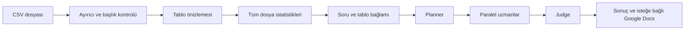

# n8n + OpenAI Çoklu Uzman Sistemi

Bu proje bir soruyu bağımsız uzman rollerine böler, uzman yanıtlarını paralel çalıştırır ve OpenAI Responses API ile tek bir nihai cevapta birleştirir. n8n workflow'ları kaynak gerçektir; Git deposundaki JSON dosyaları n8n'den dışa aktarılan sürümlerdir.

## İndirme ve yerel kurulum

1. [GitHub deposunda](https://github.com/Demko1969/Ai_Project) **Code → Download ZIP** seçeneğini kullanın ve ZIP’i açın. Önce Git geçmişindeki eski özel raporlar için [güvenlik notlarını](SECURITY.md#repository-history) okuyun. Özel depoyu indirmek için GitHub hesabınıza giriş yapmanız ve depoya erişiminiz olması gerekir. Git kullanıyorsanız `git clone https://github.com/Demko1969/Ai_Project.git` komutunu çalıştırabilirsiniz.
2. Docker Desktop’ı kurup başlatın. macOS ve Linux’ta terminali çıkardığınız proje klasöründe açıp aşağıdaki komutu çalıştırın. Windows’ta Docker Desktop’ı Linux container modunda başlatıp `scripts/start.cmd` dosyasını açın.

   ```sh
   bash scripts/start.sh
   ```

3. [Yerel uygulamayı açın](http://localhost:3000). Kurulum ekranındaki bağlantıdan yerel n8n yönetici hesabınızı oluşturun. Ardından uygulamaya dönüp **kendi OpenAI API anahtarınızı** girin. Sekiz iş akışı otomatik kurulur. İlk kurulum Docker imajlarını indirdiği için birkaç dakika sürebilir.
4. **Örnek soruyu kullan** ve ardından **Uzmanları çalıştır** düğmesine basın. CSV denemesi için `ui/tests/fixtures/support.csv` dosyasını yükleyebilirsiniz. Nihai sonuçtaki **Çözüm akışını göster** düğmesi diyagramı açar ve SVG olarak indirmenizi sağlar.

Docker, arayüz bağımlılıklarını imajın içinde kurar. Bu kurulum için bilgisayarınızda Node.js, npm veya `node_modules` klasörü gerekmez. Gerçek değerlendirmeler OpenAI API kullanımı oluşturur. Google Docs aktarımı isteğe bağlıdır ve kendi Google bağlantınızı gerektirir.

Yedekleme, Google Docs ve sorun giderme için [yerel kurulum kılavuzuna](deployment/README.md) bakın. Dağıtım kontrolleri ve bilinen sınırlar [SECURITY.md](SECURITY.md) dosyasındadır. İncelenmiş bir Git commit’inden yerel kaynak ZIP’i üretmek için `python3 scripts/package-release.py` komutunu kullanın.

## Değerlendirme geçmişi

Sonuçlar, uzman yanıtları, diyagram ve varsa Google Docs bağlantısı Docker’da `evaluation_history` volume’unda, elle kurulumda varsayılan olarak `~/.ortak-akil/evaluations.sqlite` dosyasında saklanır. Aynı yerel kurulumun tarayıcıları bu geçmişi paylaşır. Önceden kaydedilmiş tarayıcı geçmişi, o tarayıcıda uygulama ilk açıldığında içe aktarılır.

Aynı soru, model ve CSV dosyası tekrar gönderildiğinde kayıtlı sonuç yeni OpenAI isteği olmadan açılır. Yarım kalan çalışmada kaydedilmiş plan ve uzman yanıtları kullanılır. Kesinti anında henüz kaydedilmemiş çağrılar tekrar çalışabilir. **Yeniden çalıştır** yeni API kullanımı oluşturur.

**Bu değerlendirme hakkında soru sor** düğmesi, açık sonucun sorusunu, yanıtını ve değerlendirmede kullanılan CSV özetini takip sorusuna bağlar. Takip soruları da geçmişe kaydedilir.

OpenAI anahtarı n8n’in şifreli kimlik bilgisi deposunda kalır. Geçmişin yerel HTTP uç noktası tarayıcının uygulamayla aynı kaynaktan yaptığı JSON isteklerini kabul eder. Geçmişe değerlendirme metinleri ve CSV örnekleri yansıyabilir. CSV önizlemelerindeki tanınan anahtar biçimleri yeni kayıtlarda gizlenir. Eski kayıt ve yedekler için [geçmişi taşıma adımlarına](deployment/README.md#existing-history-and-backups) bakın.

## Bileşenler

- `workflows/multi-agent-planner.json`: gerekli uzman rollerini üretir.
- `workflows/multi-agent-worker.json`: tek bir uzmanın görevini çalıştırır.
- `workflows/multi-agent-judge.json`: yanıtları birleştirir ve kısa sonuç üretir.
- `workflows/multi-agent-main.json`: n8n Chat Trigger akışıdır.
- `workflows/multi-agent-ui-*.json`: web arayüzünün Plan, Worker, Judge ve Google Docs webhook'larıdır.
- `ui/`: Next.js web arayüzüdür.
- `scripts/sync-n8n.sh`: yalnızca tanımlı sekiz workflow'u n8n'den mevcut dosyalarına aktarır.

## Elle kurulum

n8n, güvenlik güncellemeleri uygulanmış Node.js ve pnpm gerekir. Web arayüzünü ve n8n'i yalnızca yerel makinede dinleyecek şekilde çalıştırın. [Elle kurulum kılavuzu](deployment/README.md#standalone-with-an-existing-local-n8n) sürüm, kimlik bilgileri, yayın sırası ve arayüz başlatma adımlarını içerir. Dört UI webhook'unda **Header Auth** seçin ve aynı sunucu anahtarını arayüze tanımlayın. OpenAI anahtarı n8n'de kalır.

Google Docs için [isteğe bağlı ayarları](deployment/README.md#optional-google-docs-export) uygulayın.

## n8n'den senkronizasyon

Varsayılan container adı `n8n`'dir:

```sh
./scripts/sync-n8n.sh
```

Farklı bir ad kullanıyorsanız:

```sh
N8N_CONTAINER=my-n8n ./scripts/sync-n8n.sh
```

Senkronizasyon sabit sekiz ID ile sınırlıdır. UI webhook'ları ve OpenAI istekleri Header Auth kullanmalıdır. Araç, sabitlenmiş örnek verileri temizler ve workflow'ları yayına kapalı yazar. Commit etmeden önce diff'i özel veriler ve n8n ayarları için inceleyin.

## Doğrulama

```sh
npm run validate
cd ui && npm test
```

Doğrulama workflow ID'lerini, bağlantıları, Code node sözdizimini, OpenAI credential kullanımını, webhook zincirlerini ve temel veri sözleşmelerini kontrol eder.

## Güvenlik

Bu kurulum tek bir güvenilir yerel operatör içindir. Webhook anahtarı ve OpenAI anahtarı ayrı olmalıdır. Yalnızca webhook anahtarı, Git dışında tutulan `ui/.env.local` dosyasına yazılabilir. OpenAI anahtarını n8n credential deposunda saklayın. Varsayılan ağ erişimi, saklama ve veri akışı için [güvenlik notlarına](SECURITY.md) bakın.

JPG, PNG ve PDF eklerinin tamamı inceleme için OpenAI’ye gönderilir. Alıntılanan bulgular geçmişe yansıyabilir. CSV için aşağıdaki örnekleme kuralları geçerlidir.

## CSV tablo analizi

Web arayüzünde sorunuzla birlikte bir UTF-8 CSV dosyası seçebilirsiniz. Ayırıcı otomatik algılanır. Tablo önizlemesi açılır ve sütun başlıkları, örnek değerler ve soru metni analiz sırasında birlikte yorumlanır. Belirsiz birim ve sütun anlamları yanıtta belirtilir.

- Dosya sınırları 1 MB, 5000 veri satırı ve 30 sütundur. Başlıklar dolu ve benzersiz olmalıdır.
- Tarayıcı tüm dosyada eksik değerleri ve sayısal sütunların toplam, ortalama, minimum ve maksimumunu hesaplar.
- Nokta ile yazılmış ondalıklar sayı olarak tanınır. Yerel para biçimleri, virgüllü ondalıklar ve tarihler metin olarak korunur. Hesaplamalar JavaScript kayan nokta sayılarını kullanır.
- Dosya adı, sütun profili ve ilk 10 satır soru bağlamına eklenerek Planner, Worker ve Judge aşamalarına taşınır. Bu bilgiler analiz için OpenAI ile paylaşılır; teknik JSON ve örnek satırlar Google Docs raporuna eklenmez.
- Büyük hücreler nedeniyle bağlam 24000 karakteri aşarsa işlem açıklayıcı bir hata ile durur.
- Destek talepleri için `cozum_saat`, `sla_hedef_saat`, `yeniden_acildi` (0/1) ve `memnuniyet_1_5` (1–5 veya boş) sütunları doğrulanırsa tam dosyada hedefe uyum, medyan, eksik puan senaryosu ve mevcut `modul`/`oncelik`/`yeniden_acildi` grupları hesaplanır. 30 grubu aşan kırılımlar atlanır. Farklı şemalar genel sütun profiliyle çalışır; yeni alan adları ve iş kuralları için uyarlayıcı eklenmelidir. Örnek satırlar tek başına tam dosya grup sonuçlarını veya nedenleri kanıtlamaz.
- Nihai sonuç kısa yönetici kararı, kritik göstergeler, öncelikli eylemler ve metinsel çözüm diyagramı olarak istenir. Docs çıktısı bu sonucu ve varsa karar belirsizliklerini içerir; bağımsız uzman cevapları web arayüzünde ayrı kalır. Modelin uzunluk ve biçim talimatlarına uyması mutlak garanti değildir.



Tablo biçimi `ui/lib/table.ts` içindeki `DataTable` sözleşmesidir:
`name`, `columns` ve `rows`. İleride Excel veya Google Sheets okuyucuları aynı
sözleşmeyi üreterek mevcut profil ve bağlam oluşturma işlevlerini kullanabilir.
Yeni kaynaklar için veri okuma ve erişim yapılandırması ayrıca geliştirilmelidir.
CSV ayrıştırma ve hesaplama testleri `cd ui && npm test` ile çalışır.
